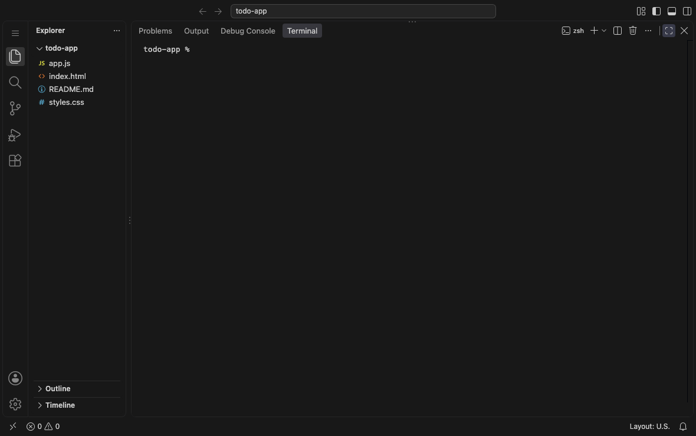
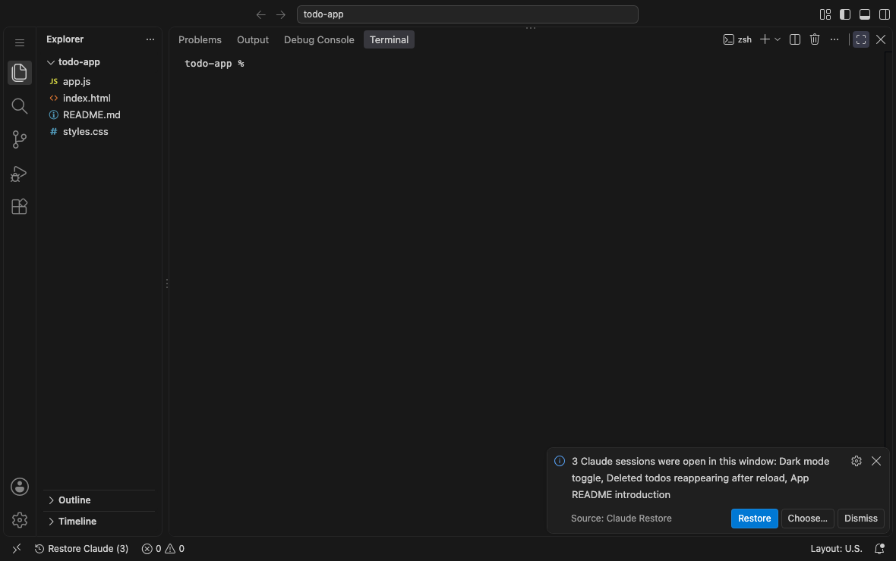
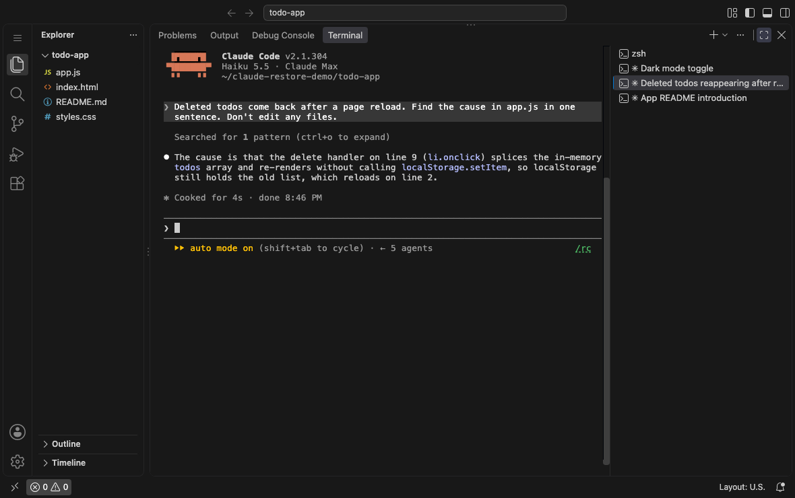

# Claude Restore (for Cursor / VS Code)

Run Claude Code in Cursor's terminal, and a window closes or crashes: this brings those sessions back in one click.

## Why I built this

I do most of my work as Claude Code sessions in Cursor's terminal, usually ten or more tabs in one window, each on its own task. Sometimes that window closes. Cursor kills its terminals when it does, and every Claude session in them goes too.

Getting them back meant opening a terminal for each one, running `claude --resume`, finding the right session in the list, and doing that again for the next one. Then putting the tabs back in the order I had them. I wanted one click that puts the window back the way it was.

## Before and after

A test run: three Claude sessions in one window, each on its own task, with the second tab in front. Then the window closes and comes back. It was shot in VS Code; the add-on is the same in Cursor.

A 26-second clip of the same test, recorded live: [examples/demo.mp4](examples/demo.mp4).

**Without Claude Restore**, the window comes back with one empty shell. The three sessions are gone.



**With Claude Restore**, the window says which sessions were open, by name.



**One click on Restore** (in the toast, or `Restore Claude (3)` in the status bar; this run used the status-bar button) brings all three back. The tabs come back in the same order, with Claude's own titles, and the tab that was in front is in front again, mid-conversation.



## How it works

- While the window is open, it notes which Claude sessions are running in its terminals (every 4 seconds).
- When the window comes back, a toast says "3 Claude sessions were open in this window" with **Restore**, **Choose…** and **Dismiss**. A status-bar button `Restore Claude (3)` does the same.
- **Restore** opens one terminal per session, in that session's folder, running `claude --resume <id>`. Claude names each tab itself with the session's live title (`✳ Fix the login bug`) when `terminal.integrated.tabs.title` includes `${sequence}`. Otherwise the tab is named after the title `/resume` shows. The toast and picker always use that title, never the auto name like `myapp-a3`.
- Tabs come back in the order they had in the tab row, and the one that was in front is in front again. Tabs dragged into a new order are restored in the order they were opened: extensions can't see drags.

It only restores sessions that were in *this* window (windows with no folder open aren't tracked), keeps its record through a full Cursor quit or crash, skips any that are already running somewhere else, and skips `claude --bg` sessions (those survive a close on their own; use `claude attach`).

Commands: `Claude Restore: Restore sessions from last time`, `…: Choose sessions to restore`, `…: Forget sessions from last time`, `…: Show log`.

Build and install:

```sh
npx --yes @vscode/vsce package --skip-license
/Applications/Cursor.app/Contents/Resources/app/bin/cursor --install-extension claude-restore-0.1.5.vsix
```

Test (no Cursor needed): `node test/harness.js`
